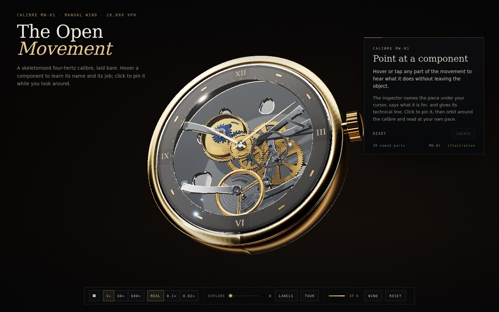

# The Open Movement

**Calibre MW-01** — an interactive, procedurally modelled skeleton watch that explains itself on hover.

[**Live exhibit**](https://gerrcass.github.io/mechanical-watch-3d/) — deployed by the Pages workflow on merge to `main` · [Spec](docs/spec.md) · [Tickets](docs/tickets.md) · [Glossary](GLOSSARY.md)



A mechanical watch is one of the few everyday objects whose working principle is invisible to its owner. This exhibit opens the movement up: every named part can be inspected, the gear train turns from one coherent ratio table, the escapement beats at 4 Hz, and the whole assembly can be separated to show how it is built.

The calibre is **illustrative** — an original 4 Hz manual-wind design, not a replica of a commercial movement.

## What you can do

| Action | Mouse | Keyboard | Touch |
| --- | --- | --- | --- |
| Orbit | drag | arrow keys | drag |
| Zoom | wheel | `+` / `−` | pinch |
| Inspect (preview) | hover | `[` / `]` | tap |
| Pin / unpin | click a part | `Enter`, `Esc` | tap again, tap away |
| Locate the part | *Locate* in the inspector | — | *Locate* |
| Explode the movement | *Explode* slider | tab to the slider | slider |
| Time-lapse | `1×`, `60×`, `600×` | tab to the speed group | speed group |
| Slow motion | `Real`, `0.1×`, `0.02×` | tab | slow group |
| Guided tour | *Tour*, then *Next* / *Leave tour* | tab | buttons |
| Labels | *Labels* | tab | button |
| Wind the mainspring | *Wind* | tab | button |
| Return to the hero view | *Reset* | `R` on the canvas | *Reset* |

The canvas is focusable. A keyboard help line appears when it is focused. The inspector announces through a dedicated `aria-live` status region, the power reserve is a `meter`, and every control is a real button, slider or group.

## The calibre

- 28,800 vph / **4 Hz**, eight beats per second, 270° balance swing.
- 20-tooth escape wheel advanced **9° per beat**, one revolution every five seconds.
- Barrel 72T → center pinion 12L (6:1) · center 64T → third 8L (8:1) · third 60T → fourth 8L (7.5:1) · fourth 72T → escape 6L (12:1).
- Center wheel one turn per hour, fourth one per minute, escape twelve per minute.
- Motion works 12T → 36T (3:1) and 10T → 40T (4:1): the hour hand turns once per twelve hours.
- 42-hour power reserve; the barrel turns once per six hours, so a full wind is seven turns.

`src/calibre/` is pure TypeScript with no Three.js import. Every angle in the scene comes from it; no scene module divides a ratio or advances a wheel.

## The object

Everything is generated at boot. There are no models, textures, HDRs or runtime font fetches.

- 38 catalogue entries with name, category, plain-language job, longer explanation, technical spec and assembly layer.
- Wheel geometry from tooth count and module, with crossings, hubs, pinions, arbors and bevelled flanks.
- Bridges shaped along their load paths, with Côtes de Genève, anglage, gold chatons, rubies and blued screws.
- Main plate with perlage and pierced openings; chapter ring with applied gold indices; gilt hands.
- A studio built from emissive softboxes and strip lights, captured to an environment map at runtime; a gradient vitrine shell; PCF shadows; ACES tone mapping; SMAA, vignette and film grain.

## Performance

Measured from `window.__openMovement.stats()` on the production build:

- **235 scene draw calls** (budget 250). The full pipeline, including the shadow map and post passes, reports more calls through `renderer.info`; the budget figure is the scene's structural count, which is what the smoke test enforces.
- **157,446 triangles** in the scene (well inside the 350k triangle budget).
- No per-frame allocation in the render loop; geometry and materials are built once, and the inspector dims shared per-part material instances rather than rebuilding the scene.
- `high` and `lite` tiers. `lite` caps DPR at 1.5, disables grain and SMAA and uses a 1024² shadow map. Small viewports and coarse pointers select it automatically; the loop demotes after sustained slow frames.

The headless capture environment renders with SwiftShader (software), so its frame rate is not representative of a GPU and 60 fps is not claimed from it. The structural budget is enforced by the smoke test.

## Accessibility and resilience

- One inspection state (`idle → preview → pinned`) drives the outline, the dim, the inspector and the live region.
- Escape clears from anywhere; brackets cycle every part; Enter pins; all controls are tabbable.
- Reduced motion removes auto-orbit and camera flights and starts in slow motion; the escapement keeps running because it is the subject.
- A no-WebGL path renders a styled page that names the calibre and lists all 38 parts with their jobs.
- The layout is composed at 1440×900 and remains usable at 360×800; the inspector becomes a bottom sheet on phones.

## Run it

```sh
npm install
npm run dev        # Vite dev server
npm run build      # type-check + production build into dist/
npm run preview    # serve the production build
npm run test       # Vitest: calibre model + DOM contract
npm run test:e2e   # Playwright smoke test against the built site
npm run lint       # tsc --noEmit + eslint
npm run shot       # build, preview, write docs/evidence/{hero,hover,exploded}.png
```

The browser tests and screenshots use `playwright-core`. Locally they drive the system Chromium (`/usr/bin/chromium-browser`) with SwiftShader; CI installs Playwright's managed Chromium and the resolver falls back to it. No browser is downloaded during a local `npm run shot`.

## Evidence

- [Hero](docs/evidence/hero.png) — the composed three-quarter view.
- [Hover](docs/evidence/hover.png) — a part previewed, with its inspector card.
- [Exploded](docs/evidence/exploded.png) — the assembly separated along the watch axis.
- [Review round 1](docs/evidence/review-round-1.md) · [Review round 2](docs/evidence/review-round-2.md) · [Review round 3](docs/evidence/review-round-3.md).

## Architecture

```text
src/
├── calibre/   pure model: constants, ratios, beat, hands, reserve, catalogue, inspection, tour, explosion
├── core/      engine, materials, procedural textures, studio, geometry factories, framing, camera flights
├── watch/     part factories and the assembly: plate, train, escapement, display, keyless, case, bridges
├── ui/        inspector, HUD, labels, fallback
└── styles/    the vitrine's typographic system
tests/         Vitest: mechanism, catalogue, reducers, DOM contract
e2e/           the browser smoke test at the built artefact
docs/          spec, tickets, ADRs, evidence
```

Decisions and concessions are recorded in [`docs/adr/`](docs/adr/). The most important one for reading the object: MW-01 is shown **skeletonised from the dial side**, with the keyless works and the barrel's open spring presented where a conventional watch would hide them.

## Honesty note

Calibre MW-01 is fictional and illustrative. The ratios, beat rate, reserve and assembly order agree with each other, and the component names and finishes follow real practice so the vocabulary transfers. It is not a replica of any commercial calibre, and no part of it is a scanned asset.
